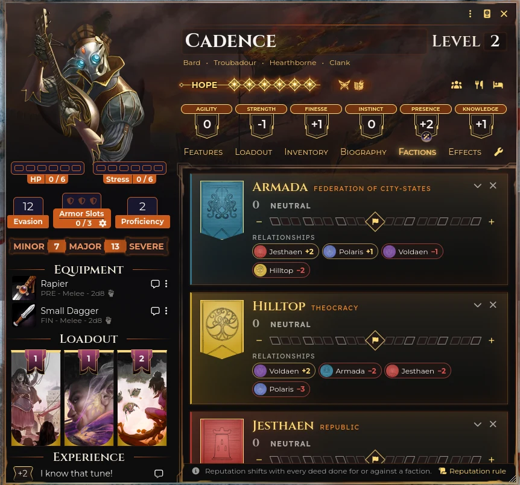
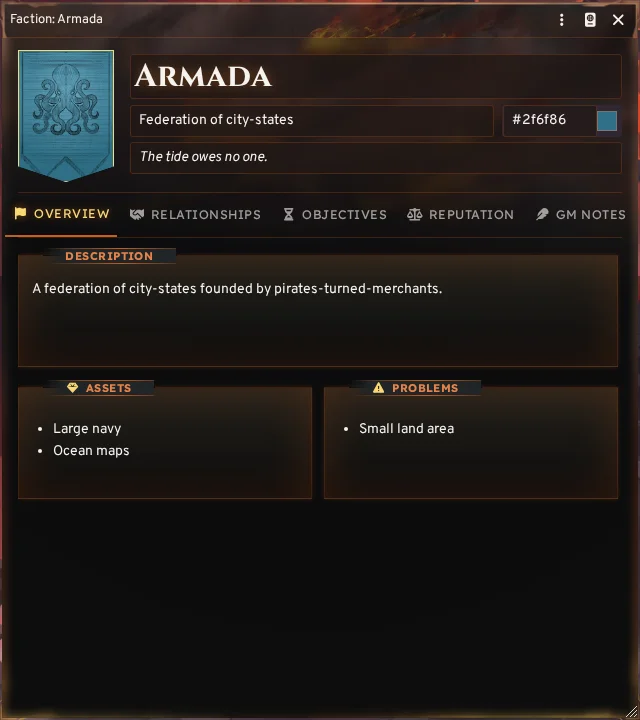
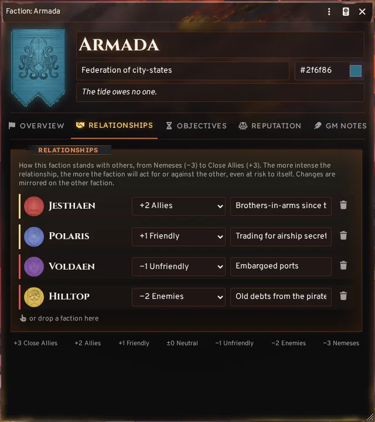
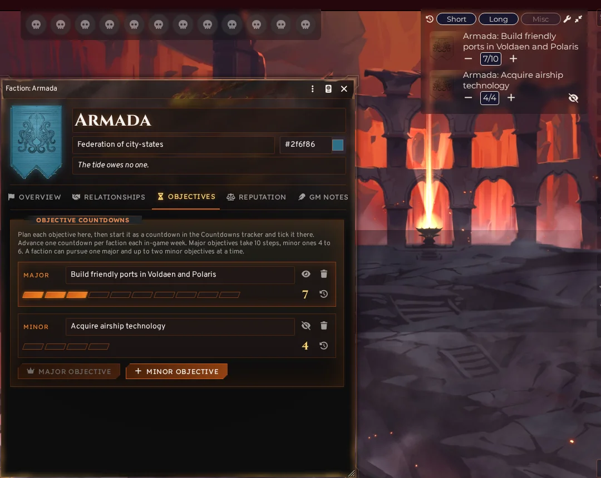
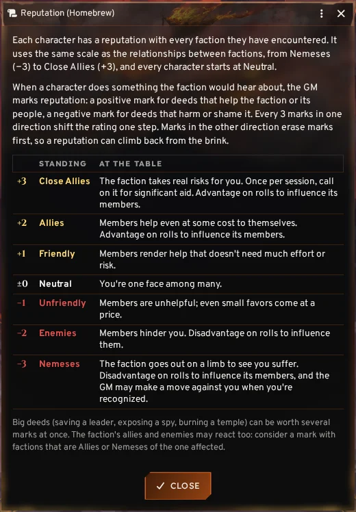

# Five Banners: Factions & Reputation

A Foundry VTT module for running the **Five Banners Burning** campaign frame in [Daggerheart](https://www.daggerheart.com). The GM creates the factions of the campaign and their relationships, and hands each faction to the characters as they meet it. Every character sheet gets a **Factions** tab that shows the factions the character knows, how those factions feel about each other and, with the homebrew reputation rule, where the character stands with each of them. The module also puts every sheet and token ring in the Five Banners Burning style of the Daggerheart Core Rulebook module.



## Requirements

- [**Foundry VTT**](https://foundryvtt.com/) v14
- [**Daggerheart**](https://foundryborne.online/) system 2.12 or later
- [**Daggerheart Core Rulebook**](https://www.foundryvtt.store/products/daggerheart-core) module (`daggerheart-core`): provides the Five Banners Burning sheet theme, token ring, banner art and layout assets this module uses. None of that is included here.

### Conflicts

Five Banners can't run alongside these modules, and they must be disabled:

- [Hotpot: Beast Feast Cooking](https://github.com/emberite/dh-hotpot) (`dh-hotpot`)
- `dh-weredragon`
- `dh-horizon`

If one of them is enabled, Five Banners stays inactive: no Factions tab, sheet theme or token ring. When the GM logs in, a prompt offers to disable the conflicting modules or Five Banners, and then reloads the world. Factions and reputations are kept either way.

## Installation

In Foundry's **Add-on Modules → Install Module**, paste this manifest URL:

```
https://github.com/emberite/dh-5banners/releases/latest/download/module.json
```

## Features

### Factions

Factions are a new item type. Create one from the Items sidebar (**Create Item → Faction**), or from the **Five Banners** section of the Daggerheart sidebar menu:

- **New Faction:** an empty faction, ready to fill in.
- **Create the Five Nations:** Armada, Hilltop, Jesthaen, Polaris and Voldaen in a *Five Banners* folder, with their banners from the Core Rulebook module and the relationship ratings from the campaign frame. Descriptions are left to you. Running it again only adds what's missing.

| | | |
|---|---|---|
|  |  |  |
| **Overview:** banner, kind, motto, color, description, assets and problems. | **Relationships:** Nemeses (−3) to Close Allies (+3) toward every other faction, with a note. | **Objectives:** one major (10 steps) and up to two minor (4–6 steps), run on the system's countdowns. |

The faction sheet has these tabs:

- **Overview:** click the banner to change the image. The faction's color fills the banner in the banner's own shape: the shape is traced from the image's transparency, so the five nations' swallowtail, notched, crenellated, shield and pointed banners each keep their outline, and so does your own banner art if it has a transparent background. Images without transparency get a simple pennant.
- **Relationships:** pick a faction from the list or drop one on the sheet, then set the rating. With *Mirror faction relationships* on (the default), the other faction gets the same rating back.
- **Objectives:** the campaign frame's objective countdowns, run on the Daggerheart system's own countdowns. Plan an objective (name, major or minor, number of steps), then click **Start countdown**: it appears in the Countdowns tracker as a narrative countdown named after the faction and the objective, with the faction's banner. Tick it there like any other countdown; the faction sheet shows its progress live. Objectives are hidden from players until you click the eye, which also shows or hides the running countdown. Removing an objective removes its countdown too.
- **Reputation:** every character who has met the faction, with their reputation. Drop a character or the party here, or use **Introduce to all player characters**.
- **GM Notes:** only the GM sees this tab.

### Meeting a faction

When the party meets a faction, drag it from the Items sidebar onto a character sheet, or onto the party sheet to introduce every character in the party at once. Dragging a faction from a compendium imports it into the world first.

The faction then shows up on the character's Factions tab, and the character's players get Observer permission on it, so they can open its sheet. Players only see the relationships with factions their character has met, and never see hidden objectives or GM notes. Factions never become items in a character's inventory.

The faction stays a single world item: when you edit it, every sheet that shows it updates. The ✕ on a faction card (GM only) removes it from that character.

### Reputation (homebrew)



Each character has a reputation with every faction they've met. It uses the same scale as the relationships between factions, and every character starts at **Neutral**:

| | Standing | At the table |
|---|---|---|
| +3 | Close Allies | The faction takes real risks for you. Once per session, call on it for significant aid. Advantage on rolls to influence its members. |
| +2 | Allies | Members help even at some cost to themselves. Advantage on rolls to influence its members. |
| +1 | Friendly | Members render help that doesn't need much effort or risk. |
| 0 | Neutral | You're one face among many. |
| −1 | Unfriendly | Members are unhelpful; even small favors come at a price. |
| −2 | Enemies | Members hinder you. Disadvantage on rolls to influence them. |
| −3 | Nemeses | The faction goes out on a limb to see you suffer. Disadvantage on rolls to influence its members, and the GM may make a move against you when you're recognized. |

When a character does something the faction would hear about, the GM marks reputation: a **positive mark** for deeds that help the faction or its people, a **negative mark** for deeds that harm or shame it. Every 3 marks in one direction (configurable) shift the rating one step. Marks in the other direction erase marks first, so a reputation can climb back from the brink. Big deeds can be worth several marks at once, and the faction's allies and enemies may react too.

On the Factions tab the track runs from Nemeses on the left to Close Allies on the right. Click a pip to set the reputation there, click the outermost filled pip again to take one mark back, or use **−** and **+**. The faction's Reputation tab shows the same track for every character who knows it.

Each faction card also has a notes field for the character's players (contacts, favors owed, grudges).

### Five Banners Burning theme and token ring

While these options are on (the default):

- **Sheets:** every sheet that supports the Core Rulebook module's themes uses the Five Banners Burning theme, whatever theme each user picked. Faction sheets always use it.
- **Token ring:** tokens use the Core Rulebook module's Five Banners Burning dynamic token ring instead of the ring set in Foundry's settings. The ring is also added to Foundry's own token ring setting as *Five Banners Burning (Core Rulebook)*.

Neither option writes to Foundry's own settings or the users' theme choices, so turning them off (or disabling the module) brings everything back as it was.

## Settings

- **Five Banners Burning sheet theme** (on by default)
- **Five Banners Burning token ring** (on by default)
- **Reputation (homebrew)** (on by default): show the reputation tracks.
- **Reputation marks per step** (3 by default): set to 1 to move the rating directly.
- **Players can mark reputation** (off by default): let players change the reputation of characters they own.
- **Mirror faction relationships** (on by default)

Disabling the module puts all of these options back to their defaults and removes the Factions tab, the sheet theme and the token ring override. Factions and the characters' reputations are kept: while the module is disabled, Foundry lists the faction items as invalid and keeps them, and they come back when the module is enabled again.

## API

`game.modules.get('dh-5banners').api` offers `introduce(faction, actors)`, `forget(actor, factionId)`, `setScore(actor, factionId, marks)`, `knownFactions(actor)`, `createAlthas()` and `showReputationRule()` for macros.

## Development

- `scripts/rules.mjs` holds the rating scale, reputation marks and relationship helpers with no Foundry dependencies.
- Releases are built by `.github/workflows/release.yml`. Publish a GitHub release tagged `vX.Y.Z`, and the workflow stamps the version and attaches `module.json` and `module.zip`.

## License

The Five Banners module (its code, templates, styles and original content) is released under the [MIT License](LICENSE). © 2026 emberite.

The MIT License doesn't cover Daggerheart material. Rules content used here falls under the notice below. The [Daggerheart Core Rulebook](https://www.foundryvtt.store/products/daggerheart-core) module's sheet themes, token ring, art and layout assets are loaded from that module at runtime and are not included in this repository.

This product includes materials from the
Daggerheart System Reference Document
2.0, © Critical Role, LLC. under the terms of
the Darrington Press Community Gaming
(DPCGL) License. More information can be
found at
https://www.daggerheart.com. There are
no previous modifications by others.
